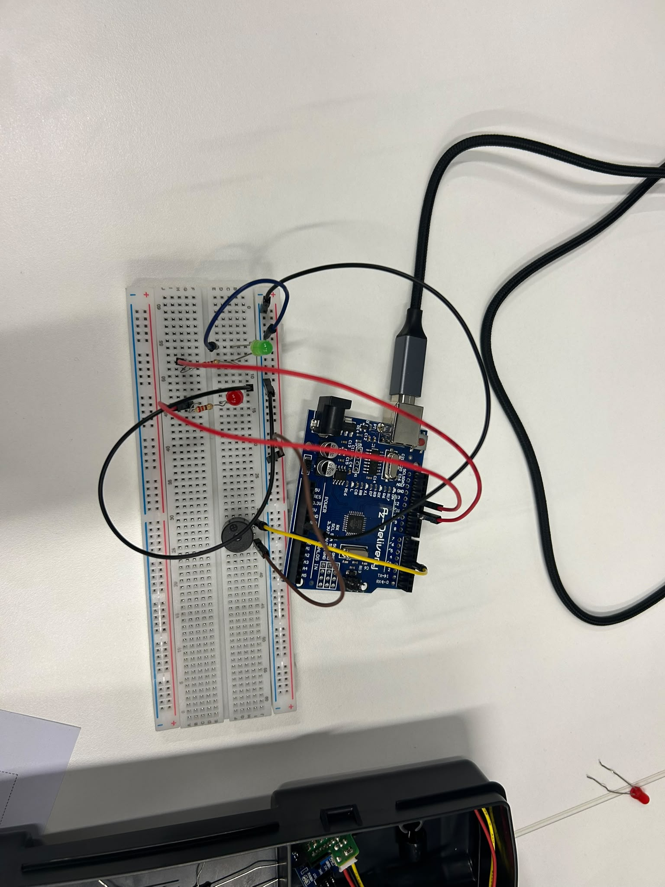

# Session 1 · Hello, physical world

**Tue 03/11** · _Tangible interaction, Arduino, basic electricity, a first LED circuit_

**Team:** Nineth Lagos, Pau Pujadas, Laia Formiga

---

## Challenge: Signal light

Design a signal with LEDs and a buzzer that means something to someone: a heartbeat, “wait”, “go”, an alarm, SOS…

**Must have** 

- [X] At least 2 LEDs, each with a correct resistor
- [x] A pattern with 3 timings: short, medium, long (e.g. 150, 400, 1000 ms)
- [x] Timings stored in variables, not typed in `delay()`
- [X] Wires in the right colours

**Hand in by 11:30**

- Code
- Photo of the circuit

---

## What we built

_Two or three sentences: what does it do, who is it for, and how does a person interact with it?_
Hem fet una alarma de movil que ens desperta.

## Materials

| Component / material | Quantity | Notes |
| -------------------- | -------- | ----- |
| Arduino Uno          | 1        |       |
| Buzzer               | 1        |       |
| Led                  | 2        |       |
| Cables               | 7        |       |
| Resistencies         | 2        |       |

## Photo

## Video
No cal s'ha dit a classe.

## Code

- Arduino sketch: [`ti01/ti01.ino`](ti01/ti01.ino)

## Which resistor, and why
No cal s'ha dit a classe.

## Problems and fixes
No funcionava el codi perquè les constants estaven en el setup i les hem posat a fora que és on havien d'anar. També les llums no s'encenien perquè hi havia el comandament d'apagar-les i encedre-les massa ràpid i no es mostrava a la realitat.

## Going further
Si, que se'ns ha acabat el temps per provar-ho i hem hagut de fer una idea més simple.

## Use of AI
No hem utilitzat IA.
