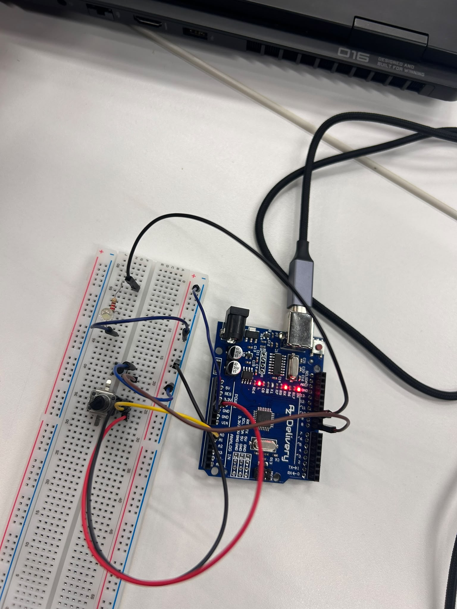

# Session 2 · Digital and analog inputs

**Thu 05/11** · _Buttons, pull-up resistors, edge detection, Serial Monitor, potentiometer, PWM, `map()`_

**Team:** _Laia Formiga, Nineth Lagos, Pau Pujadas i Ivanna Yakubiak_

---

## Challenge: Hand-dimmed lamp (graded)

Build a small lamp for a specific moment (reading, a night light, a mood) that you switch and dim by hand.

**Must have** (tick each box when it works: edit this file and change `[ ]` to `[x]`)

- [x] A potentiometer controls brightness smoothly
- [x] A button toggles the lamp on and off
- [x] Brightness is kept when you switch back on
- [x] The Serial Monitor shows the knob value

**Hand in by 11:30**

- Code
- A 10-second video

---

## What we built

Hem creat una llum d'escenari, que serveix per introducció/tancament de les peces teatrals.

## Materials

| Component / material | Quantity | Notes |
| --- | --- | --- |
| Arduino Uno | 1 | |
| Cables | 8 | |
| LED | 1 | |
| Resistència | 1 | |
| Toggle | 1 | |
| Botó | 1 | |

## Photo

## Video

https://github.com/user-attachments/assets/6969b71d-b2ca-47ee-b0d6-b23a9e73ca6a

## Code

- Arduino sketch: [`ti02/ti02.ino`](ti02/ti02.ino)
- _Other files (Tinkercad link, extra sketches…): add them to this folder or paste a link._

## The toggle
  if (lastState == HIGH && state == LOW) {
    on = !on;
    delay(30); // debounce

  Perquè el "laststate està declarat com l'estat anterior i l'state és l'actual i el comprova abans de fer cap canvi. 

  bool on = false;
int lastState = HIGH;

llavors comprova les varibles, i exacuta la funciona. 

## Problems and fixes

Una de les coses que ens havia costat ha sigut poder realitzar l'animació de fade out, perque estigui aplicada en button, per poder solucionarlo vam mirar ajudar en la pagina oficial del Arduino

## Going further

Si, hem fet el fade-out per tal de que el llum de teatre no s'apagués tan bruscament. Hem mirat a la pàgina oficial per fer el fade-out.

## Use of AI

Ho hem mirat perquè hi havia un moment que el codi no acavaba de funcionar i voliem revisar-lo i les coses estaven barrejades. També perquè ens expliqués absolutament tot el que haviem vist fins el moment de teoria que no ens havia quedat del tot clar.

