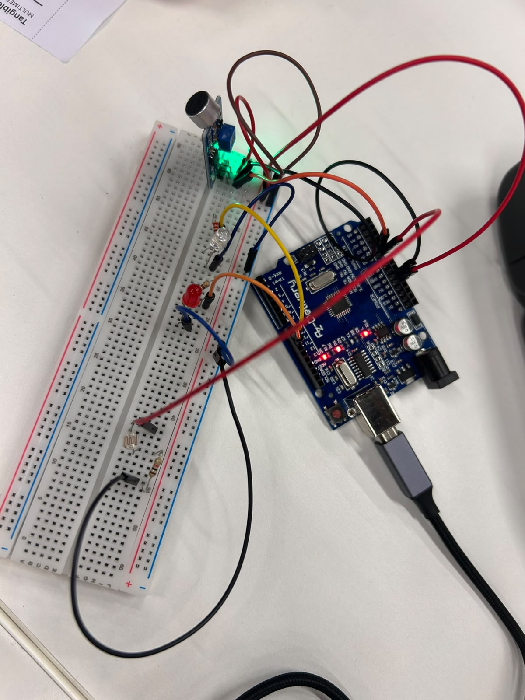

# Session 3 · Sensing the environment

**Tue 10/11** · Light, temperature, distance, pressure, knock and sound sensors; thresholds

**Team:** Ivanna Yakubiak, Nineth Lagos, Pau Pujadas i Laia Formiga

---

## Challenge: Automatic night light

A light that turns on by itself when the room goes dark, for a real place: a hallway, a child’s room, a stair.

**Must have** (tick each box when it works: edit this file and change `[ ]` to `[x]`)

- [x] LDR reading the room light
- [x] Turns on in the dark, off in the light, no flicker (two thresholds)
- [x] Thresholds come from your own measurements
- [x] Inside or on an object, not a bare breadboard
- [x] **One more sense:** hears the sound near it

**Hand in by 11:30**

- Code
- Video

---

## What we built

Hemos creado una maquina para deterctar el sonido que hace un bebe, si duerme en habitación al lado de sus padres.

## Materials

| Component / material | Quantity | Notes |
| Arduino Uno | 1 | |
| Cables | 11 | |
| LED | 2 | |
| Micro | 1 | |
| Resistencia | 3 | |
| LDR | 1 | |

## Photo

## Video

## Code

- Arduino sketch: [`ti03/ti03.ino`](ti03/ti03.ino)

## Your measurements

| Situation                 | LDR value |
| ------------------------- | --------- |
| Room light                | 100       |
| Dark                      | 0         |
| **Threshold ON** (below)  | >20       |
| **Threshold OFF** (above) | <10       |

**Extra sense we added:** detecció del so

## Problems and fixes

Hemos tenido el problema que no sabiamos como hacer que el LED rojo solo funcione cuando esta activo el LED blanco, de primeras habiamos pensado crear un if con todo dentro, pero al final donde esta el LED rojo en parte de "brillo" hemos añadido el bool inicial de la lampara.

## Going further

Detecció de so, que només funciona si la llum principal està activa.

## Use of AI

Corregir la estructura del codi.
