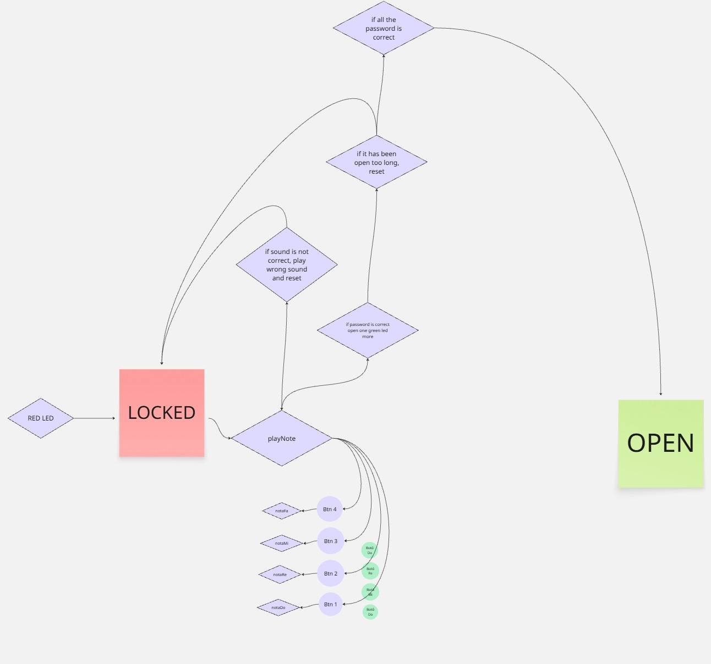

# Session 5 · Logic and states

**Tue 17/11** · _States and `switch/case`, arrays, functions, `millis()`, edge detection, RFID_

**Team:** Laia Formiga, Nineth Lagos, Pau Pujadas i Ivanna Yakubiak.

---

## Challenge: The safe box (graded)

Build a box that only opens with the right sequence. The LED strip shows whether it is locked, listening or open; buttons, knocks or an RFID card are the key.

**Must have** (tick each box when it works: edit this file and change `[ ]` to `[x]`)

- [x] At least 3 states in a `switch/case`
- [x] A code of 3+ steps stored in an array
- [x] Wrong step resets, with feedback
- [x] Closes itself after 5 s, using `millis()`

**Hand in by 11:30**

- Code
- Video
- Photo of your state drawing

---

## What we built

Com a grup hem construit un piano que amb un melodia correcta permet realitzar una entrada a lloc, que es pot posar en la porta/caixa. 

## Materials

| Component / material | Quantity | Notes |
| --- | --- | --- |
| Arduino Uno | 1 | |
| FastLed | 1 | |
| Buzzer | 1 | |
| Buttons | 4 | |
| Compressor | 1 | |
| Resistència | 1 | 330 Ohm |
| Pila | 1 | per LEDS |
| Cables | 12 | |

## Photo

## Video

https://github.com/user-attachments/assets/5a0e1c5f-4f3f-40ed-8002-6973b0b51236

## Code

- Arduino sketch: [`ti05/ti05.ino`](ti05/ti05.ino)

## States

| State | LED strip shows | Goes to… when… |
| --- | --- | --- |
| LOCKED | | |
| LISTENING | | |
| OPEN | | |

**The key:** green button, red button, yellow button, green button -- 1, 2, 3, 1

## Problems and fixes

Una cosa amb que nosaltres hem tingut el problema ha sigut introduir que quan es pulsa el numero correcta després d'una estona torna a ser vermell. 

## Use of AI

Hem utilitzat la IA per solucionar el problema que hem tingut, explicada en apartat anterior, que ens va proposar añadir un timeup extra - un només perque el codi correcte torna a ser tancat i un altre per cada teclat del piano. 
